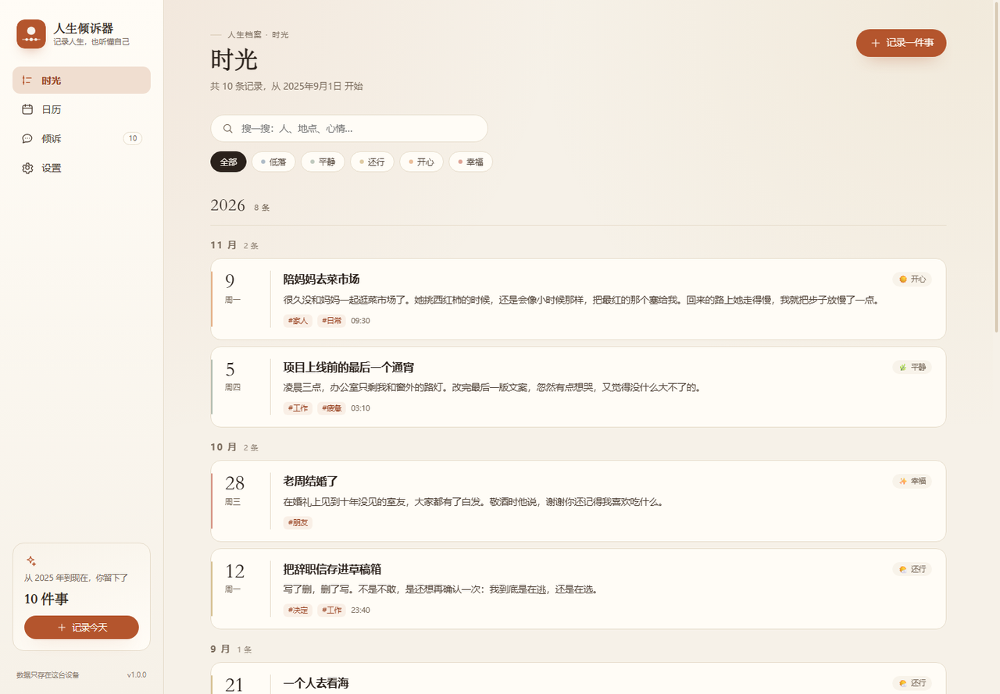
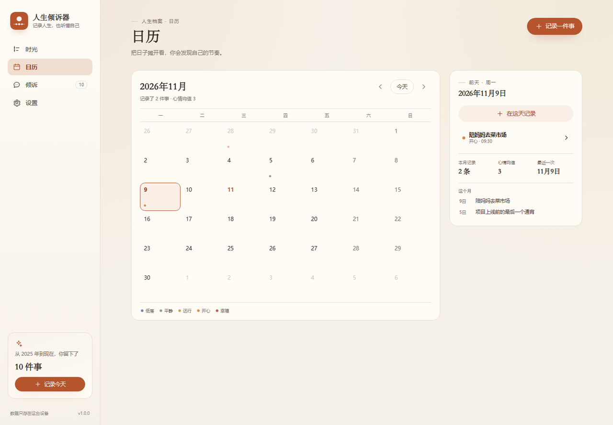
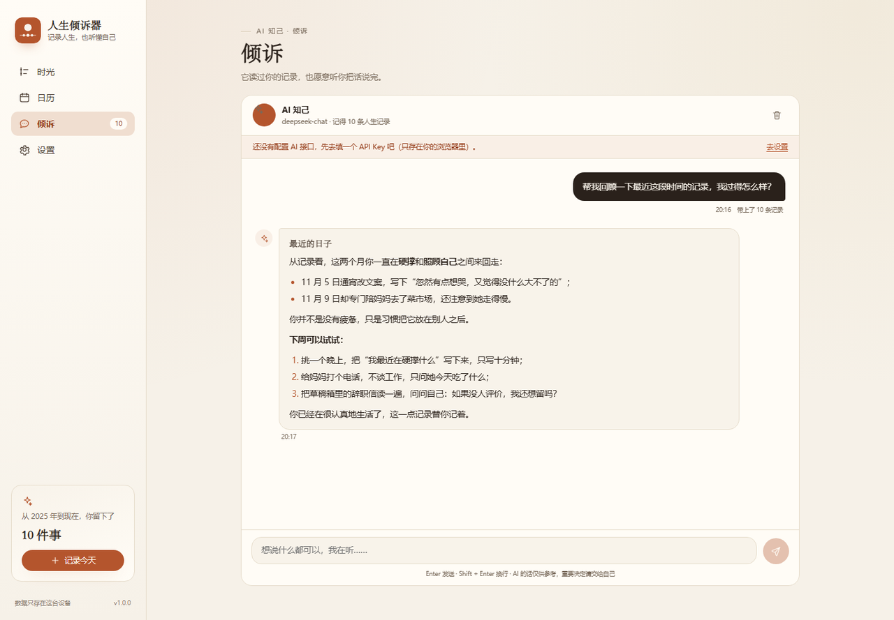
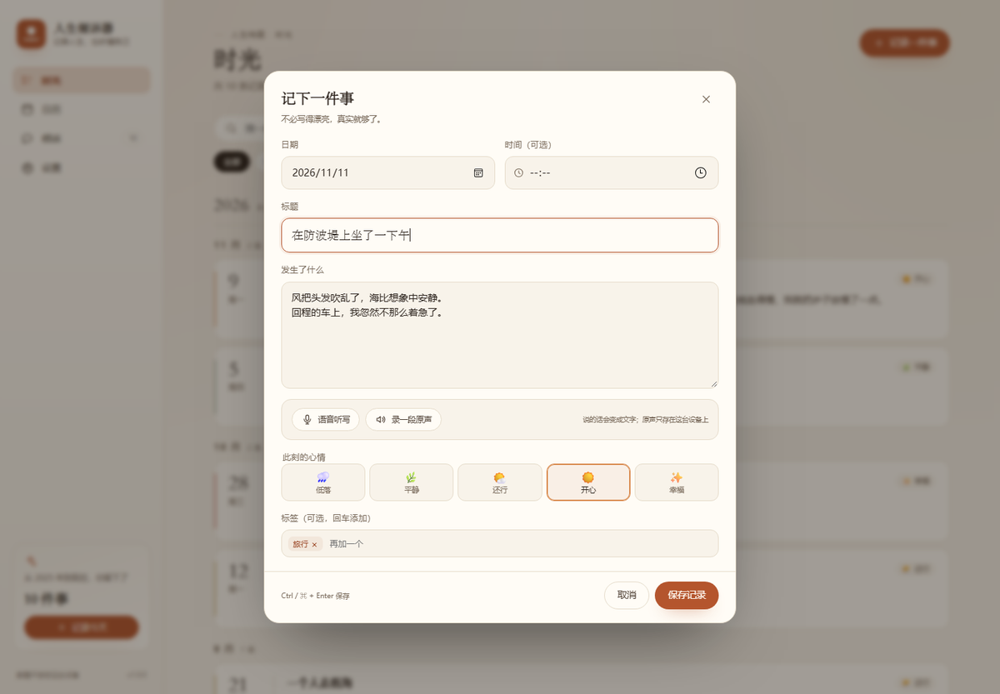
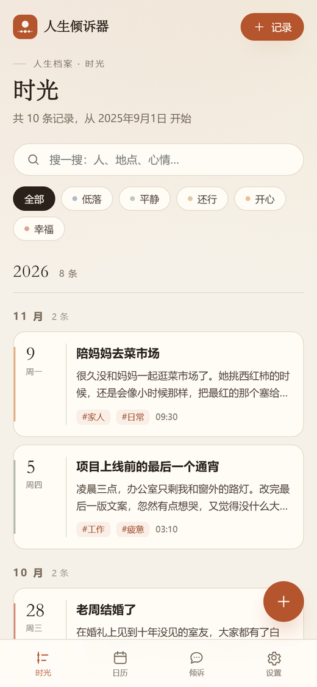

<div align="center">
  
  <h1>人生倾诉器</h1>
  <p><strong>记录人生，也听懂自己。</strong></p>
  <p>
    <a href="https://ppgod-787.github.io/life-confidant/">在线体验</a> ·
    <a href="https://github.com/ppgod-787/life-confidant/releases/latest">Windows 桌面版</a> ·
    <a href="#功能">功能</a> ·
    <a href="#本地运行">本地运行</a> ·
    <a href="#ai-配置">AI 配置</a> ·
    <a href="#数据与隐私">隐私</a>
  </p>
  <p>
    
    
    
    
  </p>
</div>

---

人生里真正重要的事，常常来不及记就过去了。

**人生倾诉器**是一个 Local-first 的人生记录本：用文字或声音留下那些时刻，在日历里看见自己走过的路，再让 AI 结合你的过往，陪你梳理、回顾、给出一点具体的建议。

它没有账号、没有服务器、没有信息流。你的记录只存在你自己的设备里。

## 功能

### 1. 说出来，或者写下来

- **语音听写**：基于 Web Speech API，说中文时实时转成文字，直接写进记录里。
- **留下原声**：也可以录一段音频（MediaRecorder），和文字一起保存在本机 IndexedDB 里，随时回听。
- 记录包含日期、时间、心情（五档）、标签和正文，写错随时改。

### 2. 在日历里看见时间

- 月历视图，每天用心情色点标出当天的记录；点开某一天，就能看到那天发生了什么。
- 时间轴按年、月自动归档，支持关键词搜索和按心情筛选。
- 日历侧栏汇总本月记录数、心情均值、最近一次记录。

### 3. 让 AI 结合你的过往给建议

- 支持所有 **OpenAI 兼容接口**：DeepSeek、OpenAI、Moonshot、硅基流动、阿里云百炼，或本地 Ollama。
- 每次对话会自动带上最近的人生记录（约 7000 字以内）、记录总数、常出现的标签和近半年心情趋势，让回答不是泛泛而谈。
- 流式回复、停止生成、重新提问；对话历史保存在本机。
- 提示词里写清了边界：不下诊断、不贴标签；遇到自伤表达时建议寻求专业帮助。

### 4. 数据在你自己手里

- 无后端、无账号、无统计脚本；断网也能记录和浏览。
- 一键导出 / 合并导入 / 覆盖导入 JSON 备份。
- 深浅色主题、移动端底部导航，手机上也能随手记。

## 截图







<p align="center">
  
  
</p>

## Windows 桌面版（双击运行）

不想装 Node、也不想每次都开浏览器？可以直接下载单文件桌面版：

**[下载人生倾诉器.exe](https://github.com/ppgod-787/life-confidant/releases/latest)**（约 0.9 MB，Windows 10 / 11 x64）

- 双击直接运行，无需安装；界面由系统自带的 Edge WebView2 渲染。
- 首次启动会把网页资源解压到 `%LOCALAPPDATA%\LifeConfidant`，记录、录音、AI 配置也保存在这里。
- 语音听写调用 Edge 的语音服务（需联网），录音和记录本身都在本机。
- 未做代码签名，SmartScreen 提示时选「更多信息 → 仍要运行」。
- 桌面版和网页版的数据互不相通（存储空间隔离），可用「设置 → 导出 / 导入」迁移。
- 想自己构建：见 [desktop/README.md](desktop/README.md)。

## 本地运行

需要 Node.js 18 或更高版本（推荐 20 / 22）。

```bash
git clone https://github.com/ppgod-787/life-confidant.git
cd life-confidant
npm install
npm run dev
```

打开终端里提示的地址（通常是 <http://localhost:5173>）。

其他命令：

```bash
npm run build     # 类型检查 + 生产构建，输出到 dist/
npm run preview   # 预览构建结果
npm test          # 运行 17 个单元测试
```

## AI 配置

1. 打开「设置 → AI 配置」，选一个服务商预设，或直接填自己的接口地址。
2. 填入 **API Key**。Key 只写进当前浏览器的 `localStorage`，请求由浏览器直接发给你填的接口。
3. 点「测试连接」确认地址、Key、模型名都没问题，然后去「倾诉」开始聊天。

| 服务商 | Base URL | 模型示例 |
| --- | --- | --- |
| DeepSeek | `https://api.deepseek.com/v1` | `deepseek-chat` |
| OpenAI | `https://api.openai.com/v1` | `gpt-4o-mini` |
| Moonshot | `https://api.moonshot.cn/v1` | `moonshot-v1-8k` |
| 硅基流动 | `https://api.siliconflow.cn/v1` | `Qwen/Qwen2.5-7B-Instruct` |
| 阿里云百炼 | `https://dashscope.aliyuncs.com/compatible-mode/v1` | `qwen-plus` |
| 本地 Ollama | `http://localhost:11434/v1` | `qwen2.5:7b` |

> 本地 Ollama 可以完全不联网，也不需要 API Key。若从线上页面（GitHub Pages）连接本地 Ollama，需要先让 Ollama 允许这个来源，例如启动前设置 `OLLAMA_ORIGINS=https://ppgod-787.github.io`（或临时设为 `*`）。

**关于跨域（CORS）：** 这是一个纯前端应用，请求由浏览器直接发往模型服务商。DeepSeek、Moonshot、硅基流动、阿里云百炼、OpenRouter 等已验证允许浏览器跨域调用；部分服务商（如智谱）默认不允许，需要自建一层转发代理，或者直接换用上表中的接口。遇到 `Failed to fetch` / CORS 报错时，先换一个服务商试试。

**AI 会看到什么？** 每次提问时，前端会把最近的记录压缩成文本（日期、心情、标题、摘要、标签）连同统计信息一起发给模型。除此之外不会上传任何东西；没有配置 AI 时，记录功能完全不受影响。

## 部署到 GitHub Pages

仓库已包含 [`.github/workflows/deploy.yml`](.github/workflows/deploy.yml)：

1. 推送到 `main` 分支。
2. 在仓库 **Settings → Pages** 里把 Source 设为 **GitHub Actions**（工作流也会尝试自动开启）。
3. 等 Actions 跑完，访问 `https://<你的用户名>.github.io/life-confidant/`。

Vite 使用相对路径构建（`base: './'`），所以部署在任意子路径下都能正常加载，不需要改配置。

## 数据与隐私

| 内容 | 存在哪里 | 说明 |
| --- | --- | --- |
| 人生记录、标签、心情 | `localStorage` | 键名 `lifeconfidant.events.v1` |
| 对话历史 | `localStorage` | 键名 `lifeconfidant.chat.v1` |
| AI 配置（含 Key） | `localStorage` | 键名 `lifeconfidant.settings.v1` |
| 录音原声 | `IndexedDB` | 数据库 `lifeconfidant`，不随 JSON 备份导出 |
| 桌面版全部数据 | `%LOCALAPPDATA%\LifeConfidant` | WebView2 用户数据目录；关闭程序后删除该文件夹即可彻底重置 |

- **没有后端**：项目是纯静态站点，不存在把记录上传到作者服务器的代码。
- **备份不含 Key**：导出的 JSON 只包含记录和主题/称呼，不会带出 API Key。
- **清除浏览器数据会丢记录**：换设备、清理浏览器或使用无痕模式前，请先导出备份。
- 录音暂不包含在 JSON 备份里，这是目前的已知限制。

## 技术栈

- **React 18 + TypeScript + Vite 6**：无 UI 框架，手写 CSS 设计系统。
- **Web Speech API**：中文语音听写。
- **MediaRecorder + IndexedDB**：原声录制与本地存储。
- **OpenAI 兼容 /chat/completions（SSE 流式）**：AI 对话。
- **Vitest**：日期、上下文构建、数据规范化等纯函数测试。
- **WebView2 + .NET Framework 4.8**：单文件 Windows 桌面外壳，内嵌网页资源。
- **GitHub Actions + Pages**：自动测试、构建、部署。

## 项目结构

```text
src/
├── components/     # 视图与交互组件（时间轴、日历、倾诉、编辑器…）
├── hooks/          # useSpeech（听写）、useRecorder（录音）
├── lib/            # 日期、存储、IndexedDB、AI 请求、上下文与数据模型
├── store/          # 全局状态与持久化（Context）
├── styles/         # 全局设计系统与响应式样式
├── App.tsx         # 布局、导航、主题、路由
└── main.tsx

desktop/            # Windows 单文件 EXE 外壳（C# WinForms + WebView2）
├── Program.cs
├── app.manifest
├── app.ico
├── build.ps1
└── README.md
```

## 已知限制

- 语音听写依赖浏览器的 Web Speech API，推荐 Chrome / Edge（Safari 支持不完整，Firefox 默认不支持）；不支持时会提示改用键盘输入。
- 语音识别在部分浏览器需要联网，并且页面需要运行在 `https://` 或 `localhost` 下。
- 桌面版需要 Windows 10 / 11 x64 与 WebView2 Runtime，EXE 未做代码签名，可能触发 SmartScreen 提示。
- 数据是单设备存储，没有云同步；多设备请用导出 / 导入迁移。
- AI 的回答可能出错，重要决定请交给自己；它不能替代心理咨询或医疗建议。

## 如果这些功能继续长大

- 端到端加密的同步（服务端只存密文）
- 每周 / 每月自动生成「人生简报」
- 把记录朗读给你听（TTS）
- 更细的标签体系与人物关系图谱

## 致谢与许可

用 [MIT License](LICENSE) 开源。欢迎提 Issue 或 PR，也欢迎把它改成只属于你自己的样子。

> 如果你正处在一段很难的时光里，请告诉身边信任的人，或拨打心理援助热线 **12356**（中国大陆）。你值得被认真对待。
